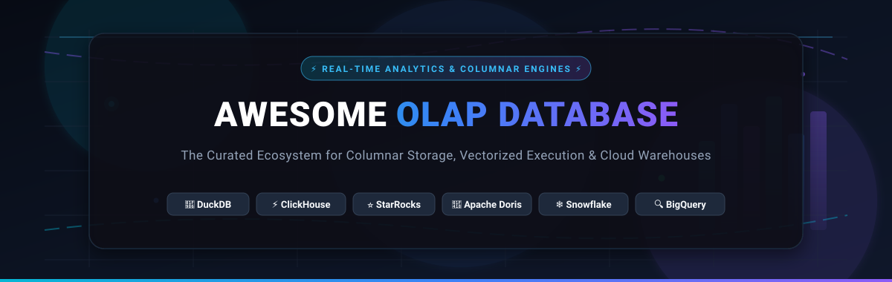
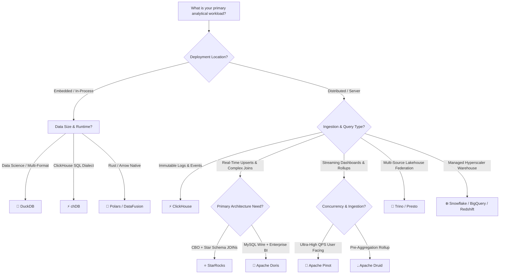

  

  
  
  
  
  
  
  

---

# 🚀 Awesome OLAP Database: The Definitive Ecosystem Guide

> A curated, SEO-optimized directory of top **Online Analytical Processing (OLAP) Databases**, **Cloud Data Warehouses**, **Columnar Storage Engines**, and **Vectorized Execution Frameworks**. Designed for data architects, analytics engineers, and backend teams building sub-second query layers over billions of rows.

---

## 📑 Table of Contents

- [🌐 Sector Overview & Market Dynamics](#-sector-overview--market-dynamics)
- [☁️ SaaS & Managed Cloud Data Warehouses](#️-saas--managed-cloud-data-warehouses)
- [⚡ Open-Source OLAP & Query Engines](#-open-source-olap--query-engines)
  - [1. ClickHouse](#1-clickhouse)
  - [2. DuckDB](#2-duckdb)
  - [3. Polars](#3-polars)
  - [4. Cube](#4-cube)
  - [5. QuestDB](#5-questdb)
  - [6. Presto](#6-presto)
  - [7. Apache Doris](#7-apache-doris)
  - [8. Apache Druid](#8-apache-druid)
  - [9. Trino](#9-trino)
  - [10. StarRocks](#10-starrocks)
  - [11. Apache DataFusion](#11-apache-datafusion)
  - [12. Databend](#12-databend)
  - [13. Apache Pinot](#13-apache-pinot)
  - [14. Apache Kylin](#14-apache-kylin)
  - [15. Hydra](#15-hydra)
  - [16. chDB](#16-chdb)
  - [17. ByConity](#17-byconity)
- [📊 Engine Selection Decision Matrix](#-engine-selection-decision-matrix)
- [🤝 How to Contribute](#-how-to-contribute)
- [📈 Star History](#-star-history)
- [💖 Support & Community](#-support--community)
- [📜 Disclaimer & Notes](#-disclaimer--notes)

---

## 🌐 Sector Overview & Market Dynamics

The global **OLAP, Analytical Database, and Cloud Data Warehousing market** was valued at approximately **$28.5 Billion in 2024** and is projected to expand at a **Compound Annual Growth Rate (CAGR) of ~16.2%**, surpassing **$68 Billion by 2030**. This growth is catalyzed by the exponential surge in real-time streaming ingestion, AI/ML feature retrieval, vector embeddings, and the enterprise shift from batch ETL toward direct lakehouse querying.

In terms of market structure, the industry exhibits a dual dynamic:
- **Enterprise Cloud Tier is Highly Concentrated (Winner-Take-Most)**: The top 4 hyperscalers and cloud warehouses—Microsoft (Azure Synapse/Fabric), Alphabet (Google BigQuery), Amazon (AWS Redshift), and Snowflake—capture more than 75% of global managed enterprise warehouse spend due to deep cloud platform integration, security compliance, and centralized governance.
- **Engine Innovation Tier is Moderately Fragmented**: The high-performance and self-hosted analytical layer is diversified across specialized, best-of-breed open-source columnar engines. Workload specialization prevents a single winner: **DuckDB** dominates in-process/embedded analytics, **ClickHouse** leads raw single-table scan throughput on immutable logs and events, **StarRocks** and **Apache Doris** outperform on real-time upserts and multi-table star schema joins, while **Trino** and **Presto** anchor federated multi-catalog data lakes.

---

## ☁️ SaaS & Managed Cloud Data Warehouses

The following table reviews the premier managed analytical databases and cloud data warehouses, sorted in **descending order by company valuation/revenue**.

| Platform | Company Valuation / Revenue | Specific Starting Pricing Tier | Free Tier Limits & Trial Conditions | Architecture & Best For |
| :--- | :--- | :--- | :--- | :--- |
| **[Azure Synapse Analytics](https://azure.microsoft.com/en-us/products/synapse-analytics)** | **~$3.12 Trillion** *(Microsoft Corp. Market Cap; Azure ~$75B+ ARR)* | **Serverless SQL**: **$5.00** per TB processed. **Dedicated SQL**: Starts at **$1.20/hour** (**$876/month** base for DW100c) + **$0.023/GB/month** standard storage. | **30-day Free Trial**: **$200 in free Azure credits** valid for 30 days, plus **12 months** of popular free tier services. | Unified analytics combining enterprise SQL data warehousing, Apache Spark big data runtimes, and Azure Data Factory data pipelines. **Best for Azure-native enterprises.** |
| **[Google BigQuery](https://cloud.google.com/bigquery)** | **~$2.15 Trillion** *(Alphabet Inc. Market Cap; Google Cloud ~$40B+ ARR)* | **On-Demand Querying**: **$6.25** per TB scanned (first 1 TB/mo free). **Standard Edition**: Starts at **$0.04/slot-hour** (**$29.20/month** per slot) + **$0.020/GB/month** active storage. | **Free-Forever Tier**: **10 GB active storage** free per month and **1 TB query processing** free per month. New accounts receive **$300 credit** for 90 days. | Fully serverless multi-cloud data warehouse with decoupled storage and compute, built-in ML, and automated geospatial analytics. **Best for GCP organizations with zero ops tolerance.** |
| **[Amazon Redshift](https://aws.amazon.com/redshift/)** | **~$1.95 Trillion** *(Amazon.com Inc. Market Cap; AWS ~$105B+ ARR)* | **Serverless**: **$0.375** per RPU-hour (minimum 8 RPUs = **$3.00/hour** active time). **Provisioned**: Starts at **$0.25/hour** (**$180/month** for dc2.large, 160 GB NVMe SSD). | **2-Month Free Trial**: **300 Redshift Processing Unit (RPU) hours** per month for 2 months (**$225 credit value**), or **750 free hours/month** of a `dc2.large` node for 2 months. | AWS-native columnar data warehouse featuring Redshift Serverless, AQUA hardware-accelerated cache, and seamless S3 data lake integration. **Best for deep AWS ecosystems.** |
| **[Snowflake](https://www.snowflake.com/)** | **~$45.0 Billion** *(Snowflake Inc. Market Cap; ~$3.6B ARR)* | **Standard Edition**: **$2.00** per credit (X-Small warehouse = 1 credit/hour = **$2.00/hour** runtime). **Storage**: **$40.00/TB/month** on-demand (**$23.00/TB/month** prepaid capacity). | **30-day Free Trial**: **$400 in free usage credits** across both compute warehouses and cloud storage without automated auto-renew locks. | Multi-cluster shared data architecture with instantaneous elasticity, native Iceberg table support, secure data sharing, and cross-cloud replication. **Best for enterprise data meshes.** |
| **[Databricks SQL](https://www.databricks.com/product/databricks-sql)** | **~$43.0 Billion** *(Databricks Valuation; ~$2.4B ARR)* | **Serverless SQL**: **$0.22/DBU** (Serverless Pro) to **$0.44/DBU** (Serverless Enterprise) (approx. **$2.20/hour** for a 2X-Small warehouse) + underlying cloud VM/storage costs. | **14-day Free Trial**: Full platform access with unlimited Serverless SQL Warehouse creation and Unity Catalog governance (user covers cloud infrastructure usage). | Serverless SQL engine powered by the C++ vectorized Photon runtime executing directly against open Delta Lake and Parquet files. **Best for unified BI over lakehouse data.** |
| **[ClickHouse Cloud](https://clickhouse.com/cloud)** | **~$2.0 Billion** *(ClickHouse Inc. Valuation; $300M+ venture funding)* | **Development Service**: Starts at **$0.09/hour** (approx. **$65/month**). **Production Service**: Starts at **$0.30/hour** (approx. **$216/month**) + **$0.034/GB/month** NVMe-backed object storage. | **30-day Free Trial**: **$300 in free usage credits** valid across Development and Production clusters with zero credit card required to start. | Fully managed serverless ClickHouse with separation of compute and object storage, automated scaling, automatic indexing, and global multi-region replicas. **Best for high-concurrency log & event analytics.** |

---

## ⚡ Open-Source OLAP & Query Engines

The open-source analytical ecosystem powers modern data platforms. The projects below are **sorted in descending order by GitHub stargazers count**.

---

### 1. ClickHouse

- **Repository**: [ClickHouse/ClickHouse](https://github.com/ClickHouse/ClickHouse) 
- **License**: Apache 2.0  
- **Architecture**: Distributed columnar OLAP storage engine featuring the **MergeTree** storage engine family, SIMD-vectorized execution, and aggressive data compression (LZ4, ZSTD, Delta, DoubleDelta, Gorilla, FSST).
- **Key Capabilities**: Unrivaled single-table scan and aggregation throughput. Operates with a minimal operational footprint utilizing **ClickHouse Keeper** (removing ZooKeeper dependency). Offers seamless schema evolution via `ALTER TABLE` without rewriting immutable data blocks.
- **Trade-offs**: Append-optimized; row-level upserts via `ReplacingMergeTree` require `FINAL` at query time, creating latency overhead for high-frequency CDC updates. Multi-table star-schema join optimization is less automated than dedicated CBO engines.
- **Best For**: High-throughput log management, telemetry, real-time observability, clickstream analytics, and time-series event processing where single-table query latency is paramount.

---

### 2. DuckDB

- **Repository**: [duckdb/duckdb](https://github.com/duckdb/duckdb)  
- **License**: MIT  
- **Architecture**: In-process, zero-dependency analytical database engine (often called the *"SQLite for Analytics"*). Implements a columnar vectorized execution engine (Morsel-driven parallelism) capable of larger-than-memory query processing.
- **Key Capabilities**: Seamless zero-copy integration with Apache Arrow, Pandas, Polars, and NumPy. Features direct querying over Parquet, CSV, JSON, and Iceberg/Delta files across local disks and S3/GCS/Azure. Includes PEG-based SQL parsing, self-hosted extensions with RSA signatures, triggers, and Selective Late Materialization (SLM).
- **Trade-offs**: Designed as single-process; does not provide distributed multi-node clustering or concurrent multi-writer support over shared storage files.
- **Best For**: Local interactive data science, client-side/embedded analytics, CI/CD pipeline data transformations, fast CLI analysis, and lightweight serverless analytics.

---

### 3. Polars

- **Repository**: [pola-rs/polars](https://github.com/pola-rs/polars)  
- **License**: MIT  
- **Architecture**: Blazing-fast DataFrames and analytical query engine written in Rust on top of the Apache Arrow memory model. Implements complete lazy evaluation with predicate pushdown, projection pushdown, and parallel streaming query execution.
- **Key Capabilities**: Vectorized columnar processing with multithreaded SIMD algorithms. Capable of handling datasets larger than RAM using its out-of-core streaming engine. Native bindings for Python, Rust, NodeJS, and R.
- **Trade-offs**: DataFrame/API-first rather than standalone SQL daemon server; not a persistent network database daemon.
- **Best For**: High-performance data wrangling, feature engineering, replacing slow Pandas workflows, and building ultra-fast batch ETL microservices.

---

### 4. Cube

- **Repository**: [cube-js/cube](https://github.com/cube-js/cube)  
- **License**: Apache 2.0  
- **Architecture**: Universal semantic layer and headless analytical caching engine for building data applications. Sits between upstream data warehouses (Snowflake, BigQuery, ClickHouse, DuckDB) and downstream applications.
- **Key Capabilities**: Automated pre-aggregations with built-in SQL API, REST API, and GraphQL endpoints. Multi-tenant access control, role-based security, and declarative data modeling with centralized governance.
- **Trade-offs**: Serves as a semantic caching and acceleration layer rather than a primary raw columnar storage engine.
- **Best For**: Customer-facing embedded dashboards, SaaS multi-tenant analytics, and standardizing enterprise metric definitions.

---

### 5. QuestDB

- **Repository**: [questdb/questdb](https://github.com/questdb/questdb)  
- **License**: Apache 2.0  
- **Architecture**: High-performance open-source time-series and analytical columnar database written in zero-GC Java and C++. Uses memory-mapped append-only columnar storage with SIMD optimizations.
- **Key Capabilities**: Nanosecond timestamp precision, InfluxDB Line Protocol (ILP) ingestion at over 4 million rows/sec per instance, PostgreSQL wire protocol compatibility, and SQL extensions like `SAMPLE BY` and `LATEST ON`.
- **Trade-offs**: Time-series ordered data orientation; less suited for arbitrary non-temporal relational graph traversals.
- **Best For**: Financial market tick data, IoT metrics, infrastructure monitoring, sensor logging, and crypto trading telemetry.

---

### 6. Presto

- **Repository**: [prestodb/presto](https://github.com/prestodb/presto)  
- **License**: Apache 2.0  
- **Architecture**: Distributed ANSI SQL query engine created at Meta (Facebook) for running interactive analytic queries against multi-petabyte data sources. Decoupled coordinator-worker architecture with in-memory pipelined processing.
- **Key Capabilities**: Federated queries joining tables across Hive/HDFS, Cassandra, relational DBMS, S3, and Kafka in a single SQL statement without data movement. Features Presto C++ (Velox) acceleration.
- **Trade-offs**: High memory requirements for distributed joins; requires external metastores and object storage.
- **Best For**: Large-scale interactive ad-hoc enterprise queries across heterogeneous lakehouses.

---

### 7. Apache Doris

- **Repository**: [apache/doris](https://github.com/apache/doris)  
- **License**: Apache 2.0  
- **Architecture**: Massively Parallel Processing (MPP) analytical database engine engineered for high-concurrency point queries and complex SQL analytics. Features **Frontend (FE)** metadata nodes (Paxos consensus) and **Backend (BE)** storage/compute nodes without ZooKeeper.
- **Key Capabilities**: MySQL wire protocol compatibility. **Unique Key data model with real-time Merge-on-Write (MoW)** for instant upserts and CDC streaming via Flink/Kafka. Advanced inverted bitmap indexing, vector search (ANN), and storage-compute separation.
- **Trade-offs**: Memory consumption under high-concurrency complex star-schema joins requires deliberate BE node sizing.
- **Best For**: Enterprise operational BI, real-time dashboards with continuous upserts, customer-facing reporting, and multi-table interactive analytics.

---

### 8. Apache Druid

- **Repository**: [apache/druid](https://github.com/apache/druid)  
- **License**: Apache 2.0  
- **Architecture**: Distributed real-time analytics data store designed for sub-second exploratory queries on event streams. Employs columnar segments with dictionary encoding, bitmap indexes, and optional ingestion-time rollup.
- **Key Capabilities**: Native, fault-tolerant streaming ingestion from Apache Kafka and AWS Kinesis with zero data loss and immediate query visibility. Pre-aggregates high-volume telemetry at ingestion to reduce scan footprints.
- **Trade-offs**: Operational complexity; requires coordinating ZooKeeper, metadata RDBMS, Deep Storage (S3/HDFS), Historicals, MiddleManagers, and Brokers. Less suited for ad-hoc multi-table joins.
- **Best For**: High-concurrency event-driven dashboards, user-facing analytical apps, network performance monitoring, and digital advertising click analytics.

---

### 9. Trino

- **Repository**: [trinodb/trino](https://github.com/trinodb/trino)  
- **License**: Apache 2.0  
- **Architecture**: Fast distributed SQL query engine (formerly PrestoSQL) designed for federated analytics at petabyte scale. Decouples compute from storage, querying data in-place without proprietary ingestion.
- **Key Capabilities**: Best-in-class catalog connectors for Apache Iceberg, Delta Lake, Apache Hudi, Hive, BigQuery, Snowflake, PostgreSQL, and Kafka. Dynamic filtering, cost-based optimizer (CBO), and fault-tolerant execution modes for long-running batch queries.
- **Trade-offs**: Pure query engine with no native storage; query performance depends on the underlying storage format and network throughput.
- **Best For**: Unified data lakehouse query federation, cross-system interactive exploration, and self-service analytics across multiple databases.

---

### 10. StarRocks

- **Repository**: [StarRocks/starrocks](https://github.com/StarRocks/starrocks)  
- **License**: Apache 2.0  
- **Architecture**: Next-generation MPP columnar database featuring a fully vectorized SIMD execution engine, a state-of-the-art Cost-Based Optimizer (CBO), and native shared-data storage-compute separation.
- **Key Capabilities**: **Primary Key storage engine with LSM-Tree indexing** providing sub-second real-time upserts and deletions. Outperforms conventional OLAP engines on complex multi-table `JOIN` queries over star and snowflake schemas without requiring denormalization into wide flat tables. Deep Iceberg, Hudi, and Delta Lakehouse integrations.
- **Trade-offs**: Primary Key index metadata consumes dedicated backend memory; requires careful cluster memory provisioning.
- **Best For**: High-throughput real-time upsert pipelines, complex multi-table star schema reporting, and high-performance serverless lakehouse analytics.

---

### 11. Apache DataFusion

- **Repository**: [apache/datafusion](https://github.com/apache/datafusion)  
- **License**: Apache 2.0  
- **Architecture**: Highly extensible, modular vectorized SQL query engine and compute library written in Rust, utilizing the Apache Arrow format in-memory.
- **Key Capabilities**: Embeddable query planner, optimizer, and physical execution engine. Serves as the foundational query execution engine behind modern cloud databases (including InfluxDB 3.0, Comet, and Cube SQL).
- **Trade-offs**: Designed as an SDK/library for building custom databases rather than a turn-key standalone database daemon with authentication and network protocols.
- **Best For**: Building modern custom analytical query engines, embedded database systems, and Arrow-native data tools.

---

### 12. Databend

- **Repository**: [databendlabs/databend](https://github.com/databendlabs/databend)  
- **License**: Apache 2.0  
- **Architecture**: Modern, cloud-native open-source data warehouse written in Rust with complete separation of compute and cloud object storage (S3, Azure Blob, GCS, MinIO).
- **Key Capabilities**: Git-style data versioning (Time Travel, Branching, Zero-copy Clone). Vectorized execution with SIMD, vectorized string algorithms, and native support for semi-structured data (JSON, Array, Tuple).
- **Trade-offs**: Relatively young ecosystem compared to established veterans; optimized primarily for cloud object stores rather than local NVMe clusters.
- **Best For**: Cost-effective, elastic cloud data warehousing as an open-source alternative to Snowflake.

---

### 13. Apache Pinot

- **Repository**: [apache/pinot](https://github.com/apache/pinot)  
- **License**: Apache 2.0  
- **Architecture**: Real-time distributed OLAP datastore originally built at LinkedIn for ultra-high concurrency user-facing analytical applications. Uses columnar segments with pluggable index types (Star-Tree, Inverted, Range, JSON, Timestamp, Text).
- **Key Capabilities**: Capable of serving hundreds of thousands of queries per second (QPS) with millisecond latencies over real-time streaming pipelines (Kafka, Pulsar). Includes real-time upsert support via partition-aware routing.
- **Trade-offs**: Optimized for low-latency filtering and aggregation rather than deep arbitrary multi-table distributed joins.
- **Best For**: Customer-facing analytical features (e.g., LinkedIn "Who viewed your profile"), live financial dashboards, and high-concurrency operational telemetry.

---

### 14. Apache Kylin

- **Repository**: [apache/kylin](https://github.com/apache/kylin)  
- **License**: Apache 2.0  
- **Architecture**: Distributed analytical engine designed to provide a SQL interface and multi-dimensional analysis (MOLAP) on large-scale datasets over Hadoop, Spark, and Parquet.
- **Key Capabilities**: Precomputes multi-dimensional cubes (cuboids) at scale using distributed Spark jobs. Delivers deterministic sub-second query response times regardless of data volume since queries scan precomputed aggregates.
- **Trade-offs**: Inflexible ad-hoc querying outside pre-aggregated dimensions; long cube build preparation times; resource-intensive batch builds.
- **Best For**: Traditional enterprise BI cubes, fixed-dimension multi-billion row executive dashboards, and predictable reporting over massive Hadoop/Spark lakes.

---

### 15. Hydra

- **Repository**: [hydradatabase/hydra](https://github.com/hydradatabase/hydra)  
- **License**: Apache 2.0 / PolyForm  
- **Architecture**: Open-source columnar data warehouse built directly into PostgreSQL. Adds a columnar table storage format to standard Postgres with vectorized execution.
- **Key Capabilities**: Query analytical workloads without leaving Postgres or setting up complex ETL pipelines. Retains standard Postgres ecosystem tooling, foreign keys, extensions, and ORM support.
- **Trade-offs**: Single-node or limited distributed scaling; columnar performance does not match standalone specialized engines like ClickHouse or StarRocks on massive petabyte clusters.
- **Best For**: Teams standardizing on PostgreSQL wanting analytical columnar performance without adopting a separate external warehouse.

---

### 16. chDB

- **Repository**: [chdb-io/chdb](https://github.com/chdb-io/chdb)  
- **License**: Apache 2.0  
- **Architecture**: In-process SQL OLAP engine powered by ClickHouse core. Embeds ClickHouse's execution engine directly into Python, C/C++, Rust, Go, and Node.js runtimes without running an external server daemon.
- **Key Capabilities**: Queries Parquet, CSV, JSON, Arrow, and SQLite files locally using ClickHouse's SIMD SQL engine. Zero-copy data exchange with Python dictionaries, Pandas, and Arrow tables.
- **Trade-offs**: Embedded/in-process focus; not designed for multi-node distributed clustering.
- **Best For**: Python data pipelines, lightweight data processing inside serverless AWS Lambda / Cloud Functions, and local ClickHouse SQL testing.

---

### 17. ByConity

- **Repository**: [ByConity/ByConity](https://github.com/ByConity/ByConity)  
- **License**: Apache 2.0  
- **Architecture**: Open-source cloud-native data warehouse originally developed by ByteDance, forked and re-architected from ClickHouse to decouple storage and compute.
- **Key Capabilities**: Stateless compute workers with shared storage on HDFS/S3, multi-tenant resource isolation, transaction support with snapshot isolation, and elastic auto-scaling.
- **Trade-offs**: More operational infrastructure components to deploy and manage than standard single-binary ClickHouse.
- **Best For**: Large-scale multi-tenant enterprise data platforms requiring ClickHouse performance with independent compute-storage elasticity.

---

## 📊 Engine Selection Decision Matrix

Choosing the right analytical database depends on your query topology, update pattern, and deployment footprint:

---

## 🤝 How to Contribute

We welcome contributions from the data engineering community! To add or update an OLAP database entry:

1. **Fork the Repository**: Click the `Fork` button on the top right.
2. **Create a Feature Branch**: `git checkout -b feat/add-new-olap-engine`
3. **Follow the Standard Structure**:
   - Project Name, official GitHub link, and social Stars_Badge.
   - License, Core Architecture, Standout Capabilities, Trade-offs, and Best Use-Cases.
   - For SaaS products, include verifiable starting price tiers and specific free-tier terms.
4. **Submit a Pull Request**: Provide a concise explanation and citations to official documentation or release notes.

> [!TIP]
> Ensure all external links are valid and descriptions remain strictly factual, comparative, and technical.

---

## 📈 Star History

---

## 💖 Support & Community

Thank you for visiting and supporting **Awesome-OLAP-Database**! If this ecosystem guide helped clarify your analytical data architecture, assisted in engine benchmarking, or saved you research time:

- ⭐ **Star this repository** to improve visibility for the data engineering community.
- 🍴 **Fork and contribute** your production insights, benchmarks, and architectural additions.
- 📢 **Share with peers** on Reddit (`r/dataengineering`), Hacker News, Twitter/X, and LinkedIn.
- ☕ **Sponsor & Buy a Coffee**: Consider sponsoring ongoing maintenance and updates via the [GitHub Sponsor Dashboard](https://github.com/sponsors/ishandutta2007).

---

## 📜 Disclaimer & Notes

- This is a community-curated technical index and comparison guide; all trademarks, logos, and brand names belong to their respective owners.
- OLAP architectures entail deliberate trade-offs between scan speed, update mutability, join execution, and operational complexity. Always benchmark candidates with realistic production schemas, concurrency profiles, and ingestion rates.
- *Last updated: 2026.*
